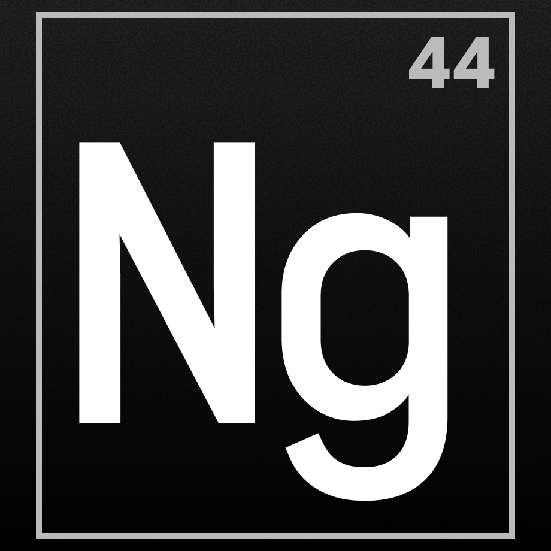

# Tired of reading AI slop?

> Give it a bit of Noble Gas...

## What is Noble Gas?

Noble Gas is a Chrome Extension for rewriting text content on any webpage using [Google's Gemini 4 Argon model.](https://blog.google/innovation-and-ai/models-and-research/gemini-models/introducing-gemini-4-argon/) Argon is particularly adept at writing prose and can do a pretty good job at making arbitrary LLM "slop" much more readable, understandable, and concise.

## See it in action

| | VIDEO HERE | |

## Try it out

> [!NOTE]
> You need a Gemini API key in order to use Noble Gas.

There are two ways to use Noble Gas:

1. Download the [latest prebuilt ZIP](https://github.com/rorz/Noble-Gas/releases/latest/download/noble-gas-chrome.zip), unzip it, then open `chrome://extensions`, enable **Developer mode**, and choose **Load unpacked** to select the unzipped folder.
2. Clone the repo and run it as a dev extension.

_Noble Gas is not distributed publicly on the Chrome Web Store._
